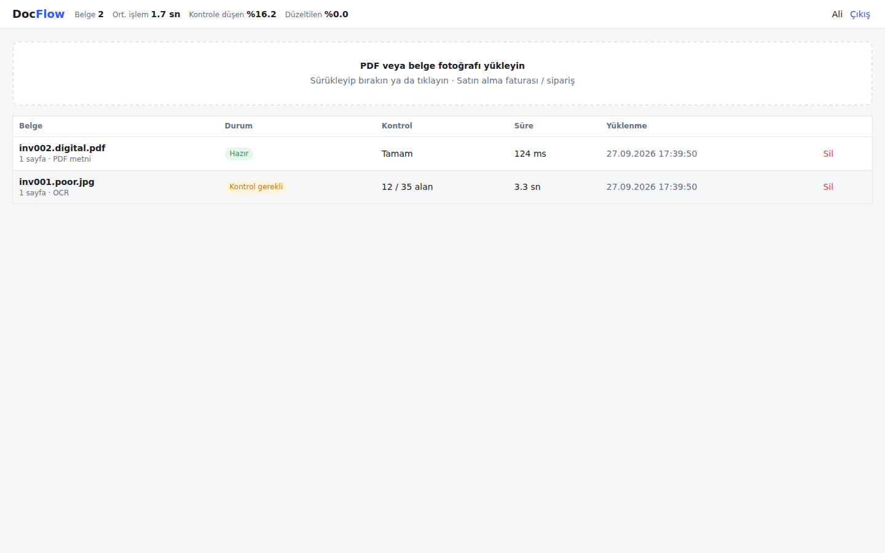

<div align="center">

# DocFlow

### Turning Purchase Documents into Verified, Exportable Tables

[](https://www.python.org/)
[](https://fastapi.tiangolo.com/)
[](https://github.com/tesseract-ocr/tesseract)
[](https://sqlite.org/)
[](https://pytest.org/)
[](https://www.docker.com/)
[](https://github.com/alitopraktug/docflow/actions/workflows/ci.yml)

**DocFlow** reads invoices and purchase orders from PDFs or phone photos, extracts header fields and line items, shows where every value came from in the original document, and hands only the values it cannot verify to a person. Reviewed results download as Excel or CSV.

**Designed and built by [Ali Toprak Tuğtekin](https://github.com/alitopraktug) · ATT**

[Features](#core-features) · [How It Works](#how-it-works) · [Evaluation](#evaluation) · [Installation](#installation) · [Testing](#testing)

</div>

---

## Overview

OCR is good at reading text and bad at knowing when it is wrong. A misread digit in an invoice total can come back with the same confidence as a correct one, and a pipeline that trusts it passes the error straight into accounting.

DocFlow treats extraction as a workflow instead of a single recognition step: documents are processed in resumable background jobs, every number is cross-checked against the others, uncertain values are routed to human review, and every correction is stored and reused.

| Documents and background jobs | Review screen with source highlighting |
|---|---|
|  |  |

The interface is in Turkish because the first supported document family is Turkish purchase invoices (VKN tax IDs, KDV/VAT, Turkish number and date formats). English labels are also recognised.

## Core Features

| Capability | How it works |
|---|---|
| **Background jobs with progress** | Uploading returns immediately. A worker processes the document stage by stage (`rasterize → ocr → extract`) and the list shows live progress such as `OCR: page 2/3`. |
| **Source of every value** | Each field stores its page, bounding box and the raw text OCR produced. Selecting a field highlights it on the page image; clicking a highlight selects the field. |
| **Human review for uncertain fields** | Low confidence, malformed values, arithmetic mismatches, failed tax ID checksums and missing required fields are marked `needs_review`. A document cannot be approved while any field is pending. |
| **Stored corrections** | Every correction, confirmation and row edit is written to an append-only audit log with the old value, new value and original OCR reading. When OCR later produces the same reading of a text field such as the supplier name, the user's earlier fix is applied automatically. |
| **Duplicate detection** | Byte-level: a SHA-256 hash per user, so re-uploading a file opens the existing document instead of starting a new job. Content-level: a different file with the same supplier and invoice number (for example a scan of an existing PDF) is flagged as a possible duplicate. |
| **Per-user isolation** | Every document query is scoped to the caller. Another user's document returns 404 on every endpoint, so its existence is not revealed. Files are stored per user and duplicate detection never crosses users. |
| **Excel and CSV export** | CSV is one row per line item with the header repeated (import-friendly, UTF-8 with BOM for Excel). XLSX has formatted *Belge* (document), *Kalemler* (line items) and *Düzeltmeler* (corrections) sheets, with pending and corrected cells highlighted. |

## How It Works

```text
Upload (PDF or photo)
        |
        v
SHA-256 check per user -----------> existing document
        |
        v
Job queue in SQLite (leased, resumable)
        |
        v
rasterize  ->  ocr  ->  extract  ->  validate
 PDF text      illumination   labels,      cross-checks,
 layer or      + deskew,      line-item    confidence,
 page image    per-page       table        suggestions
               checkpoint
        |
        v
Review screen  <->  corrections, re-validation, audit log
        |
        v
Approve  ->  Excel / CSV
```

- **Digital PDFs** use their embedded text layer, so no OCR guessing is involved.
- **Scans and photos** are cleaned before recognition: uneven lighting is flattened by dividing by a blurred background estimate, and skew is corrected with a projection-profile search. The straightened image is the one shown to the reviewer, so highlights line up with the text.
- **Extraction** matches Turkish and English labels with fuzzy matching (so `Fatura N0:` still matches), parses Turkish and international number formats, and rebuilds table rows geometrically so a row stays together even when OCR splits its columns.

## Handling OCR Uncertainty

*Does the system accept a misread digit as if it were certain?* No. OCR confidence alone never decides.

1. **Independent cross-checks** ([`validate.py`](docflow/validate.py)): `quantity × unit price = amount`, `Σ amounts = subtotal`, `subtotal × VAT rate = VAT`, `subtotal + VAT = total`, plus the VKN tax ID checksum. A single misread digit breaks at least one of these equations and the fields involved go to review.
2. **Verified values are trusted, unverified values must be confident.** An amount confirmed by arithmetic is accepted even with a lower OCR score. A supplier name, which nothing can verify, is accepted only when OCR is confident.
3. **No silent fixes.** When the arithmetic implies a different value, it is shown as a suggestion next to the field (for example *Öneri: 2.542,48*). Applying it is the reviewer's decision.
4. **Character confusions are flagged.** Repairs such as `O→0`, `S→5` or `%→9`, unexpected characters such as `PO-1665$`, and product codes that mix look-alike characters (`8SA` vs `85A`) send the field to review.
5. **Re-validation after every edit.** Correcting one amount re-runs every check, so a subtotal that now adds up is cleared automatically.

The result is measurable: in the evaluation below, **silent errors** (wrong values that were auto-accepted) stay at 0% at every quality level.

## Resumable Processing

*If processing stops half way, can it restart?* Yes, from where it stopped ([`pipeline.py`](docflow/pipeline.py), [`worker.py`](docflow/worker.py)).

- A job stores the name of its **next stage**. Each stage writes its output and advances that pointer **in the same database transaction**, so a half-written result is never visible.
- OCR, the slowest step, is checkpointed **per page**. If a 40-page document fails on page 25, the first 24 pages are not recognised again.
- Workers claim jobs with a **lease** and renew it while they make progress. If a worker dies (`kill -9`, a server restart), the lease expires and another worker takes over. A job with a live lease cannot be stolen, and a worker that has lost its lease stops without writing anything.
- Failed attempts are re-queued automatically. After `max_attempts` the job is marked failed and the **Yeniden dene** (retry) button resumes it, skipping the stages that already finished.
- The extract stage is idempotent: re-running it replaces the machine output as a whole, so nothing is duplicated.

All of this is covered in [`tests/test_resume.py`](tests/test_resume.py), including a job that crashes on page 2 and is completed by a second worker that only re-reads page 2.

## Evaluation

The same 20 synthetic invoices were processed at four quality levels. Documents follow the real path: HTTP upload → queue → worker → database.

| Quality | Field accuracy | Sent to review | Silent errors | Errors caught | Mean time | p95 time |
|---|---|---|---|---|---|---|
| Digital PDF | 100.0% | 0.0% | 0.0% | 100.0% | 99 ms | 115 ms |
| Scan (200 dpi) | 100.0% | 5.2% | 0.0% | 100.0% | 3.9 s | 4.6 s |
| Phone photo | 99.5% | 5.5% | 0.0% | 100.0% | 3.1 s | 3.2 s |
| Poor photo | 83.1% | 29.6% | 0.0% | 100.0% | 2.7 s | 3.0 s |

As document quality drops, accuracy drops too, but the system notices: errors move to the review list instead of disappearing. On poor photos about 30% of fields go to a person, which is far better than a wrong value entering accounting unnoticed. Digital PDFs skip OCR entirely and are processed in about 0.1 seconds.

Quality levels: *scan* is 200 dpi with light noise; *phone photo* is 130 dpi, ~1° skew, blur, uneven lighting and JPEG quality 45; *poor photo* is 100 dpi, ~2° skew, heavier blur and noise, and JPEG quality 25. The full report is in [`eval/results.md`](eval/results.md).

The top bar of the application shows the same metrics live for the signed-in user: average processing time, share of fields sent to review, and share of fields the user corrected.

## Technologies

- Python
- FastAPI
- SQLite (WAL)
- Tesseract OCR
- PyMuPDF
- Pillow and NumPy
- openpyxl
- Vanilla JavaScript, HTML and CSS
- Pytest
- Docker and GitHub Actions

## Project Structure

```text
docflow/
|
|-- docflow/
|   |-- api.py          # HTTP endpoints, user isolation, upload and duplicate detection
|   |-- worker.py       # Leased job claiming, renewal, failure handling and retries
|   |-- pipeline.py     # Checkpointed stages, learned corrections, content duplicates
|   |-- ocr.py          # PDF text layer, image clean-up, deskew, Tesseract, line rebuilding
|   |-- extract.py      # Label matching (TR/EN), number/date/VKN parsing, line-item table
|   |-- validate.py     # Cross-checks, confidence, review decision, suggestions
|   |-- review.py       # Corrections, confirmations, row edits, re-validation, audit log
|   |-- export.py       # CSV and formatted XLSX export
|   |-- db.py           # Schema and SQLite helpers
|   `-- static/         # Web interface (no build step)
|
|-- samples/
|   |-- generate.py     # Synthetic invoices at four quality levels with ground truth
|   `-- examples/       # Two ready-to-upload invoices in every quality level
|-- eval/
|   `-- evaluate.py     # Field accuracy, review rate, silent errors, processing time
|-- tests/              # Parsing, validation, resumable jobs and API tests
|-- Dockerfile
|-- docker-compose.yml  # API and two workers sharing one data volume
`-- requirements.txt
```

## Installation

Requirements: Python 3.11+ and Tesseract with the Turkish language pack (`tesseract-ocr`, `tesseract-ocr-tur`).

```bash
git clone https://github.com/alitopraktug/docflow.git
cd docflow
pip install -r requirements.txt
```

## Run the Application

```bash
uvicorn docflow.api:create_app --factory --reload
# open http://localhost:8000
```

By default the worker runs as a thread inside the API process. To run workers as separate processes:

```bash
DOCFLOW_EMBEDDED_WORKER=0 uvicorn docflow.api:create_app --factory
python -m docflow.worker   # start as many workers as you like
```

With Docker (API and two workers sharing one data volume):

```bash
docker compose up --build
```

Configuration is done with environment variables: `DOCFLOW_DATA_DIR`, `DOCFLOW_REVIEW_THRESHOLD` (default `0.90`), `DOCFLOW_OCR_LANG` (default `tur+eng`), `DOCFLOW_LEASE_SECONDS`, `DOCFLOW_MAX_ATTEMPTS`, `DOCFLOW_MAX_UPLOAD_MB` and `DOCFLOW_EMBEDDED_WORKER`.

## Testing

```bash
pip install -r requirements-dev.txt
pytest -q
```

The suite covers number, date and tax ID parsing; cross-check decisions (including a confidently misread digit); crash-and-resume at page level; lease expiry and takeover; failure and retry; user isolation on every endpoint; file and content duplicates; corrections, learned fixes and re-validation; row edits; non-ASCII file names; and CSV/XLSX export.

To reproduce the evaluation:

```bash
python samples/generate.py --count 20
python eval/evaluate.py         # writes eval/results.md
```

## API

| Method | Path | Description |
|---|---|---|
| POST | `/api/auth/register` | Creates a user and returns a session token |
| POST | `/api/documents` | Uploads a file (201 new, 200 with `duplicate: true`) |
| GET | `/api/documents` | The user's documents with job status and progress |
| GET | `/api/documents/{id}` | Fields, line items, source boxes, issues and suggestions |
| GET | `/api/documents/{id}/pages/{n}` | Page image in the same coordinate system as the boxes |
| PATCH | `/api/documents/{id}/fields/{fid}` | Corrects a value (Turkish and international formats accepted) |
| POST | `/api/documents/{id}/fields/{fid}/confirm` | Confirms that a value is correct |
| POST / DELETE | `/api/documents/{id}/rows[/{row}]` | Adds or deletes a line item |
| POST | `/api/documents/{id}/approve` | Approves the document (409 while fields are pending) |
| POST | `/api/documents/{id}/retry` | Resumes a failed job from its last completed stage |
| GET | `/api/documents/{id}/export.csv?sep=;` / `export.xlsx` | Export |
| GET | `/api/documents/{id}/corrections` | Audit log |
| GET | `/api/stats` | Processing time, review rate and correction rate for the user |

## Demo Walkthrough

1. Upload the digital PDF, the scan and the poor photo of the same invoice from `samples/examples/` and watch the progress bars. The scan is flagged as a possible duplicate of the PDF.
2. Upload the same file again: no new job starts and the existing document opens.
3. Open the poor photo and step through the highlighted fields with **Sonraki kontrol →** (next review). Each field shows where it is on the page, what OCR read, and why it needs review (for example *Miktar × birim fiyat ≠ tutar*, quantity × unit price ≠ amount). Apply a suggestion and watch the related flags clear.
4. Approve the document and download the Excel file: highlighted cells and the *Düzeltmeler* sheet carry the audit trail.
5. Sign in as a second user: the first user's documents are not visible.
6. Stop the workers in the middle of a job (`docker compose kill worker`) and start them again (`docker compose start worker`): the job continues from the page where it stopped.

## Limitations

- Extraction is rule-based and tuned for single-layout Turkish and English purchase invoices. Other layouts would need more label rules or a layout-aware model.
- The evaluation uses synthetic documents. The same script runs on real documents given an `<id>.json` ground truth next to each file.
- Authentication is a demo: a name-based sign-up with a bearer token. Page images and downloads also accept the token as a query parameter; production would use short-lived signed URLs.
- SQLite with WAL fits a single server. Multiple servers would need PostgreSQL (`SELECT ... FOR UPDATE SKIP LOCKED`) and object storage; the job queue design stays the same.

## Future Improvements

- A layout-aware extraction model behind the same validation layer, compared with the existing evaluation script
- More document families, starting with product catalogues
- Supplier profiles that learn each supplier's layout from confirmed documents
- Batch upload of ZIP archives and e-mail inbox import
- Role-based review with a second approver for high-value invoices

## Project Purpose

DocFlow is a portfolio project demonstrating:

- End-to-end document processing from upload to verified export
- Resumable background jobs with leases and checkpoints
- Defensive validation that knows when OCR is wrong
- Human-in-the-loop review with source traceability
- Audit logging and learning from user corrections
- Multi-user data isolation and duplicate detection
- Measurable quality across documents of different quality

---

## Developer

**Ali Toprak Tuğtekin**

Computer Engineer

Building practical software at the intersection of backend systems, machine learning, and thoughtful product design. DocFlow is designed, developed, and maintained under the **ATT** signature.

- GitHub: [alitopraktug](https://github.com/alitopraktug)
- LinkedIn: [Ali Toprak Tuğtekin](https://linkedin.com/in/ali-toprak-tuğtekin-b97b11341)

---

<div align="center">

Built to make document automation honest about what it does not know.

</div>
