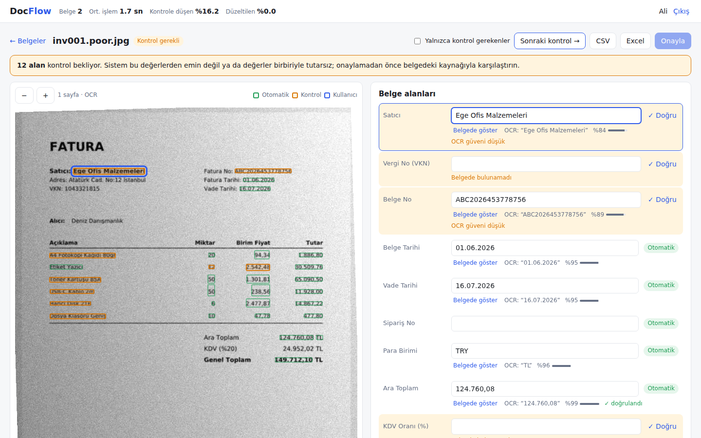
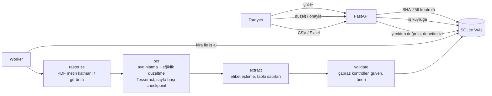

# DocFlow

Satın alma belgelerini (fatura / sipariş) **doğrulanabilir bir tabloya** dönüştüren uygulama.
Kullanıcı bir PDF ya da belge fotoğrafı yükler; DocFlow belge alanlarını ve kalem satırlarını çıkarır,
her değerin belgede nereden okunduğunu gösterir, emin olmadığı değerleri insan kontrolüne bırakır ve
onaylanan sonucu Excel/CSV olarak verir.

> Belge işleme, backend ve kullanıcı onayı tek bir iş akışında: **yükle → arka planda işle → kontrol et → düzelt → onayla → indir.**

| Belge listesi ve arka plan işleri | Kaynağı gösteren inceleme ekranı |
|---|---|
|  |  |

## Neler var

| İstenen | Nasıl karşılanıyor |
|---|---|
| Uzun işlemler için arka plan görevleri ve ilerleme | Yükleme anında biter; iş `jobs` tablosuna kuyruklanır. Worker aşama aşama çalışır (`rasterize → ocr → extract`), ilerleme ve mesaj (`OCR: sayfa 2/3`) arayüzde canlı görünür. |
| Çıkarılan değerin belgedeki kaynağı | Her alan sayfa numarası, sınırlayıcı kutu (bbox) ve OCR'ın okuduğu ham metinle saklanır. Alana tıklayınca sayfa görüntüsünde ilgili bölge vurgulanır; kutuya tıklayınca alan seçilir. |
| Belirsiz alanları insan kontrolüne bırakma | Düşük güven, biçim hatası, **aritmetik tutarsızlık**, VKN kontrol hanesi hatası, eksik zorunlu alan → `needs_review`. Bekleyen alan varken belge onaylanamaz. |
| Kullanıcı düzeltmelerini saklama | Her düzeltme/onay/satır ekleme-silme `corrections` tablosuna eski değer, yeni değer ve OCR okumasıyla birlikte yazılır (denetim izi, Excel'de ayrı sayfa). Ayrıca aynı OCR okuması tekrar gelirse kullanıcının düzeltmesi otomatik uygulanır (`correction_rules`). |
| Aynı dosyanın tekrar yüklenmesini tanıma | Bayt düzeyinde: SHA-256, kullanıcı başına benzersiz; tekrar yükleme yeni iş başlatmaz, mevcut belgeye yönlendirir. İçerik düzeyinde: farklı dosya ama aynı satıcı + belge numarası (ör. PDF'in taranmış hali) → "olası mükerrer" uyarısı. |
| Farklı kullanıcıların belgelerini ayırma | Tüm belge sorguları `user_id` ile filtrelenir; başka kullanıcının belgesi için her uç nokta 404 döner (varlığı bile sızmaz). Dosyalar kullanıcı klasörlerinde, tekrar tespiti kullanıcı içinde yapılır. |

## Mühendislik soruları

### "OCR yanlış rakam okursa sistem bunu kesin doğru kabul ediyor mu?"

Hayır. Tesseract yanlış bir rakamdan %95 emin olabilir, bu yüzden **OCR güveni tek başına karar vermez**:

1. **Bağımsız çapraz kontroller** ([`validate.py`](docflow/validate.py)):
   `miktar × birim fiyat = tutar`, `Σ tutar = ara toplam`, `ara toplam × KDV oranı = KDV`,
   `ara toplam + KDV = genel toplam`, VKN kontrol hanesi. Tek bir rakam yanlış okunduğunda bu eşitliklerden
   en az biri bozulur ve ilgili alanlar kontrole düşer.
2. **Doğrulanan değer güvenilir, doğrulanamayan değer eşik altındaysa kontrole gider.** Aritmetikle
   doğrulanmış bir tutar düşük OCR güvenine rağmen kabul edilir; satıcı adı gibi doğrulanamayan metinler
   yalnızca OCR güveni yüksekse kabul edilir.
3. **Sessizce düzeltme yok.** Aritmetik başka bir değeri işaret ediyorsa bu `suggested_value` olarak
   gösterilir ("Öneri: 2.542,48"); uygulamak kullanıcının kararıdır.
4. **Karakter karışıklıkları işaretlenir.** `O→0`, `S→5`, `%→9` gibi onarımlar yapıldığında, `PO-1665$` gibi
   beklenmeyen karakterlerde ya da `8SA / 85A` gibi benzer harf-rakam içeren ürün kodlarında alan kontrole düşer.
5. **Düzeltme sonrası yeniden doğrulama.** Kullanıcı bir tutarı düzelttiğinde tüm kontroller yeniden çalışır;
   ara toplam artık tutuyorsa onun işareti de kalkar.

Sonuç ölçülebilir: aşağıdaki değerlendirmede **"sessiz hata"** (yanlış ama otomatik kabul edilmiş alan)
her kalitede %0.

### "İşlem yarıda kalırsa yeniden başlatılabiliyor mu?"

Evet, kaldığı yerden ([`pipeline.py`](docflow/pipeline.py), [`worker.py`](docflow/worker.py)):

- İş, **bir sonraki aşamanın adını** (`stage`) saklar. Her aşama çıktısını yazar ve bu işaretçiyi
  **aynı veritabanı işleminde** ilerletir; yarım sonuç hiçbir zaman görünür olmaz.
- En yavaş adım olan OCR **sayfa bazında** kaydedilir: 40 sayfalık belgede 25. sayfada çökerse, yeniden
  başladığında ilk 24 sayfa tekrar okunmaz.
- Worker işi **kira (lease)** ile alır ve ilerledikçe yeniler. Worker ölürse (`kill -9`, sunucu yeniden
  başlatma) kira süresi dolar, başka bir worker işi devralır. Kirası geçerli bir iş başkası tarafından alınamaz;
  kirasını kaybeden worker hiçbir şey yazmadan durur.
- Hata alan iş otomatik olarak yeniden kuyruğa girer; `max_attempts` sonrası "başarısız" olur ve arayüzden
  **Yeniden dene** ile tamamlanan aşamalar atlanarak sürdürülür.
- Çıkarım aşaması idempotenttir: tekrar çalışması makine çıktısını bütünüyle değiştirir, çift kayıt oluşmaz.

Bunların hepsi [`tests/test_resume.py`](tests/test_resume.py) içinde test edilir (ör. 2. sayfada çöken
işin, başka bir worker tarafından yalnızca 2. sayfa tekrar okunarak tamamlanması).

## Değerlendirme

Aynı 20 sentetik fatura dört kalitede işlendi (`samples/generate.py` üretir, `eval/evaluate.py` ölçer;
belgeler gerçek yolu izler: HTTP yükleme → kuyruk → worker → veritabanı):

| Kalite | Belge | Alan | Alan doğruluğu | İnsan kontrolüne giden | Sessiz hata | Yakalanan hata | Süre ort. | Süre p95 |
|---|---|---|---|---|---|---|---|---|
| Dijital PDF | 20 | 632 | %100.0 | %0.0 | %0.0 | %100.0 | 97 ms | 124 ms |
| Tarama (200 dpi) | 20 | 632 | %100.0 | %5.2 | %0.0 | %100.0 | 3937 ms | 4661 ms |
| Telefon fotoğrafı | 20 | 632 | %99.5 | %5.5 | %0.0 | %100.0 | 2999 ms | 3118 ms |
| Kötü fotoğraf | 20 | 632 | %83.1 | %29.6 | %0.0 | %100.0 | 2662 ms | 2988 ms |

Okuma şekli: belge kalitesi düştükçe doğruluk düşüyor, ama sistem bunu **fark ediyor**: hatalar
kaybolmak yerine kontrol listesine taşınıyor. Kötü fotoğrafta alanların %30'u insana gidiyor; bu,
yanlış bir değerin muhasebeye sessizce girmesinden iyidir. Taramadaki süre, görüntünün daha büyük
olmasından (200 dpi) kaynaklanıyor. Dijital PDF'lerde OCR hiç çalışmaz, metin katmanı kullanılır.

Kalite seviyeleri: *tarama* 200 dpi + hafif gürültü; *telefon* 130 dpi, ~1° eğim, bulanıklık, eşit
olmayan ışık, JPEG %45; *kötü* 100 dpi, ~2° eğim, daha fazla bulanıklık ve gürültü, JPEG %25.
Görüntüler OCR öncesi aydınlatma düzeltmesi (arka plan bölme) ve eğiklik düzeltmesi (projeksiyon profili)
ile iyileştirilir.

Uygulamanın üst çubuğu aynı metrikleri kullanıcının kendi belgeleri için canlı gösterir: ortalama işlem
süresi, kontrole düşen alan oranı ve kullanıcının değiştirdiği alan oranı.

## Çalıştırma

Gereksinimler: Python 3.11+, Tesseract (`tesseract-ocr` ve Türkçe dil paketi `tesseract-ocr-tur`).

```bash
pip install -r requirements.txt
uvicorn docflow.api:create_app --factory --reload
# http://localhost:8000
```

Varsayılan olarak worker API süreci içinde bir thread olarak çalışır. Ayrı süreçlerde çalıştırmak için:

```bash
DOCFLOW_EMBEDDED_WORKER=0 uvicorn docflow.api:create_app --factory
python -m docflow.worker   # istediğiniz kadar worker başlatabilirsiniz
```

Docker ile (API + 2 worker, ortak veri hacmi):

```bash
docker compose up --build
```

Testler ve değerlendirme:

```bash
pip install -r requirements-dev.txt
pytest -q
python samples/generate.py --count 20
python eval/evaluate.py         # eval/results.md dosyasını yazar
```

Ayarlar (ortam değişkenleri): `DOCFLOW_DATA_DIR`, `DOCFLOW_REVIEW_THRESHOLD` (vars. 0.90),
`DOCFLOW_OCR_LANG` (vars. `tur+eng`), `DOCFLOW_LEASE_SECONDS`, `DOCFLOW_MAX_ATTEMPTS`,
`DOCFLOW_MAX_UPLOAD_MB`, `DOCFLOW_EMBEDDED_WORKER`.

## Mimari



```
docflow/
  api.py        HTTP uç noktaları, kullanıcı ayrımı, yükleme ve tekrar tespiti
  worker.py     kira tabanlı iş alma, yenileme, hata ve yeniden deneme
  pipeline.py   checkpoint'li aşamalar, öğrenilmiş düzeltmeler, içerik mükerrer tespiti
  ocr.py        PDF metin katmanı, görüntü iyileştirme, eğiklik düzeltme, Tesseract, satır oluşturma
  extract.py    etiket eşleştirme (TR/EN, bulanık), sayı/tarih/VKN ayrıştırma, kalem tablosu
  validate.py   çapraz kontroller, güven skoru, kontrol kararı, öneriler
  review.py     düzeltme, onay, satır ekleme/silme, yeniden doğrulama, denetim izi
  export.py     CSV (Excel uyumlu) ve biçimli XLSX (Belge / Kalemler / Düzeltmeler)
  static/       arayüz (bağımlılıksız HTML/CSS/JS)
samples/generate.py   sentetik fatura + 4 kalite + doğru cevap
eval/evaluate.py      alan doğruluğu, kontrol oranı, sessiz hata, süre
tests/                ayrıştırma, doğrulama, kaldığı yerden devam, API
```

### API

| Yöntem | Yol | Açıklama |
|---|---|---|
| POST | `/api/auth/register` | Kullanıcı oluşturur, oturum anahtarı döner |
| POST | `/api/documents` | Dosya yükler (201 yeni, 200 `duplicate: true`) |
| GET | `/api/documents` | Kullanıcının belgeleri, iş durumu ve ilerleme |
| GET | `/api/documents/{id}` | Alanlar, kalemler, kaynak kutuları, sorunlar, öneriler |
| GET | `/api/documents/{id}/pages/{n}` | Sayfa görüntüsü (kutularla aynı koordinat sistemi) |
| PATCH | `/api/documents/{id}/fields/{fid}` | Değer düzeltme (TR/EN sayı ve tarih biçimi kabul edilir) |
| POST | `/api/documents/{id}/fields/{fid}/confirm` | "Değer doğru" onayı |
| POST / DELETE | `/api/documents/{id}/rows[/{row}]` | Kalem satırı ekleme / silme |
| POST | `/api/documents/{id}/approve` | Belgeyi onaylar (bekleyen alan varsa 409) |
| POST | `/api/documents/{id}/retry` | Başarısız işi kaldığı aşamadan sürdürür |
| GET | `/api/documents/{id}/export.csv?sep=;` / `export.xlsx` | Dışa aktarma |
| GET | `/api/documents/{id}/corrections` | Denetim izi |
| GET | `/api/stats` | Kullanıcının işlem süresi, kontrol ve düzeltme oranları |

## Mülakatta gösterim akışı

1. `samples/examples/` altındaki aynı faturanın dijital PDF'ini, taramasını ve kötü fotoğrafını yükleyin;
   listede ilerleme çubuklarını gösterin. Tarama için "olası mükerrer" uyarısı çıkar.
2. Aynı dosyayı tekrar yükleyin: yeni iş başlamaz, mevcut belge açılır.
3. Kötü fotoğrafı açın, **Sonraki kontrol →** ile sarı alanları gezin; her alanın belgede nerede olduğunu,
   OCR'ın ne okuduğunu ve neden kontrole düştüğünü ("Miktar × birim fiyat ≠ tutar") gösterin.
   Öneriyi uygulayın, diğer alanların işaretinin kalktığını gösterin.
4. Onaylayın, Excel'i indirin: sarı/mavi hücreler ve "Düzeltmeler" sayfası denetim izini taşır.
5. İkinci kullanıcıyla giriş yapın: ilk kullanıcının belgeleri görünmez.
6. Worker'ı işlem ortasında durdurun (`docker compose kill worker` ya da süreci öldürün), yeniden başlatın:
   iş kaldığı sayfadan devam eder.
7. `python eval/evaluate.py` tablosunu açın: kalite düştükçe doğruluk düşüyor, sessiz hata sıfırda kalıyor.

## Bilinen sınırlar ve sonraki adımlar

- Çıkarım kural tabanlıdır ve TR/EN etiketli tek sayfa düzenli faturalar için ayarlıdır. Farklı şablonlar
  için bir düzen modeli (LayoutLM, Donut) ya da bir LLM çıkarıcısı `extract.py` yerine takılabilir;
  doğrulama katmanı ve iş akışı aynen kalır. Değerlendirme betiği bu değişikliği ölçmek için hazır.
- Değerlendirme sentetik belgelerle yapıldı; gerçek belge setiyle aynı betik çalıştırılabilir
  (`<id>.json` doğru cevap + görüntü).
- Kimlik doğrulama gösterim amaçlıdır (isimle kayıt, taşıyıcı anahtar). Görüntü ve indirme bağlantıları
  için anahtar sorgu parametresiyle de kabul edilir; üretimde kısa ömürlü imzalı URL kullanılmalı.
- SQLite + WAL tek sunucu için yeterli; çok sunucuda PostgreSQL (`SELECT ... FOR UPDATE SKIP LOCKED`) ve
  nesne depolama gerekir. İş kuyruğu tasarımı aynı kalır.
